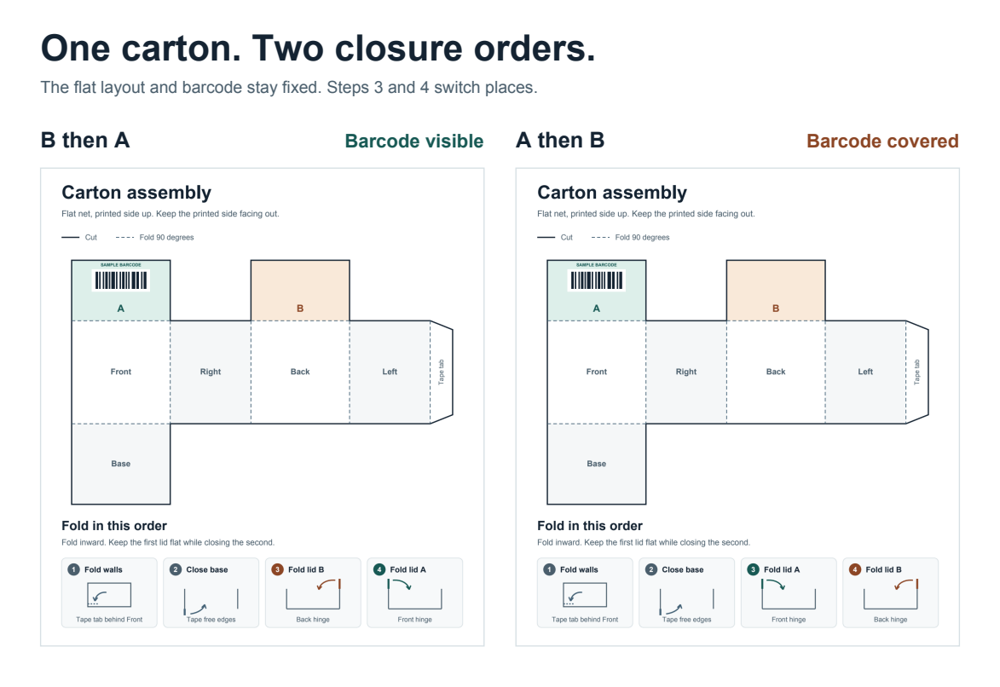

# First-round results

## See the signature pair

Both images ask, “After closing the carton as shown, is the entire barcode visible from outside?” The checker projects the same 260 mm² barcode to the top plane in both cases. When A closes first, B covers the entire barcode. When A closes last, all 260 mm² stays exposed. [Task manifest](output/sample/tasks.jsonl) · [Automated validation](output/sample/validation.json) · [A4 folding sheet](output/pdf/carton.pdf)

## Recorded runs

Runs used separate Codex CLI sessions at `low` reasoning effort. The signature carton was used for the demo. The six evaluation tasks came from three different seeded layouts. The model saw one input at a time and received a short reply-format instruction with the question. [Fresh layout manifest, seed 2026](output/evaluation/tasks.jsonl)

| Pack and input | Model | Items correct | Pairs correct | Parse errors | Raw report |
| --- | --- | ---: | ---: | ---: | --- |
| Signature, image and question | `gpt-6.2-sol` | 2/2 | 1/1 | 0 | [JSON](output/sample/scores-vision.json) |
| Signature, text only | `gpt-6.2-sol` | 1/2 | 0/1 | 0 | [JSON](output/sample/scores-text.json) |
| Held-out, image and question | `gpt-6.2-sol` | 6/6 | 3/3 | 0 | [JSON](output/evaluation/scores-vision.json) |
| Held-out, image and question | `gpt-6.1-terra` | 5/6 | 2/3 | 0 | [JSON](output/evaluation/scores-terra-vision.json) |
| Held-out, text only | `gpt-6.2-sol` | 0/6 | 0/3 | 3 | [JSON](output/evaluation/scores-text.json) |

| Held-out task | GPT-6.2 Sol items / pair | GPT-6.1 Terra items / pair | GPT-6.2 Sol text-only items / pair |
| --- | --- | --- | --- |
| Visibility | 2/2 · 1/1 | 1/2 · 0/1 | 0/2 · 0/1 |
| Placement | 2/2 · 1/1 | 2/2 · 1/1 | 0/2 · 0/1 |
| Repair | 2/2 · 1/1 | 2/2 · 1/1 | 0/2 · 0/1 |

### A missed fold-order change

On task `1c3fe31ccc2b`, GPT-6.1 Terra replied `No`. The diagram closes A first and B second. The barcode is on B, so the full 216 mm² is visible. Terra replied `No` to the reverse order as well, where 96 mm² is covered. That gave it 1/2 items on the pair and zero pair credit. [Missed input](output/evaluation/images/1c3fe31ccc2b.png) · [Closed-carton reveal](output/evaluation/reveals/1c3fe31ccc2b.png) · [Reverse order](output/evaluation/reveals/15d178c79d2e.png)

Both vision runs kept the same correct `Back` answer when only the side-wall colors changed. Sol's text-only run produced three guesses with the wrong choice and three replies with extra prose, which the one-choice parser rejected. These pilot results cover three held-out layouts and one run per condition. They show the specific fold-order miss and the cosmetic control outcome for this pack. [Automated evaluation checks](output/evaluation/validation.json)

## Verification evidence

- 27 regression tests passed. They cover complete and partial occlusion, hinge clearance, the 1 mm ambiguity guard, wall orientation, unique repair choices, deterministic seeds, print sizing, tampered and linked files, outbound payloads, and failure scoring.
- Both packs regenerated in a clean directory. Re-scoring the saved raw replies reproduced the totals for all five live runs.
- The dependency audit reported zero known advisories for the four pinned Python packages at the time of the scan. [Dependency audit](output/qa/dependency-audit.json)
- Blind teammate responses and real folding photos are pending. The evaluation above used the generated diagrams. [Observation procedure and record](PHYSICAL_CHECK.md)
